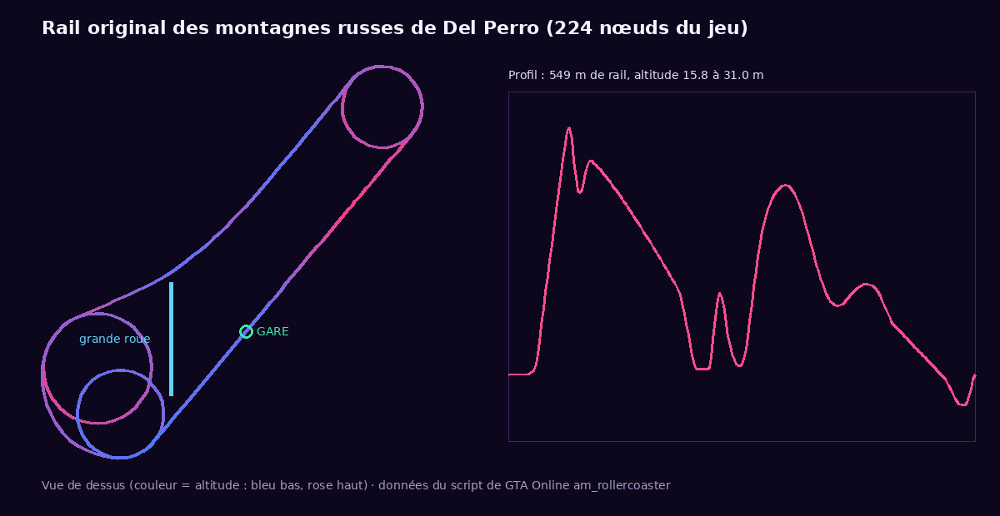

# elyzea_pier — Parc d'attractions de Del Perro

La **grande roue** et les **montagnes russes** ORIGINALES du ponton de Del Perro, jouables en multijoueur sur la base Elyzea.
Les tickets s'achètent auprès d'un PNJ, sont rangés dans l'inventaire du serveur (`elyzea_inventory`) et sont consommés au moment
de l'embarquement.



## 1. Ce qui est réutilisé du jeu original
Rien n'a été recréé avec des objets personnalisés. La ressource reprend **les modèles, le rail, les positions et les animations**
que GTA Online utilise lui-même pour ces deux attractions (scripts `am_ferriswheel` et `am_rollercoaster`, version décompilée
publique, voir `tools/extract_track.py`) :

| | Grande roue (« Ferris Whale ») | Montagnes russes (« Leviathan ») |
|---|---|---|
| Modèles | `prop_ld_ferris_wheel` + 16 `prop_ferris_car_01` | `ind_prop_dlc_roller_car` + 3 `ind_prop_dlc_roller_car_02` |
| Position | centre −1663,97 / −1126,70 / 30,70, rayon 15,3 m | 224 nœuds du rail original (549 m, de 15,8 à 31 m d'altitude) |
| Mouvement | rotation de la roue, cabines toujours droites (formule du jeu) | vitesse du jeu : chaîne de montée, gravité, vitesses de référence de Rockstar ; orientation lissée par quaternions |
| Places | 16 cabines × 2 passagers (32) | 4 wagons × 2 passagers (8) |
| Animations | `anim@mp_ferris_wheel` (entrée, assis, sortie) | `anim@mp_rollarcoaster` (entrée, barre de sécurité, bras levés, sortie) |
| Points du quai | point d'embarquement original | 8 points d'embarquement et 8 points de sortie originaux |

## 2. Installation
1. Copier **`elyzea_pier`** dans `resources` (à côté des ressources Elyzea).
2. Remplacer **`elyzea_inventory/shared/items.lua`** et ajouter les 2 images **`elyzea_inventory/html/img/ticket_grande_roue.png`**
   et **`ticket_montagnes_russes.png`** (déclaration des 2 tickets, comme les jetons du casino). C'est la seule modification
   d'une autre ressource.
3. Dans `server.cfg`, la ligne est ajoutée après `elyzea_casino` : `ensure elyzea_pier` (après `elyzea_core` et `elyzea_inventory`).
4. Redémarrer (ou `refresh`, `ensure elyzea_inventory`, `ensure elyzea_pier`).

Dépendances : `elyzea_core`, `elyzea_inventory`, OneSync. Aucune table SQL, aucun stream, aucun fichier à télécharger.

## 3. Pour les joueurs
1. Aller voir le **vendeur de tickets** (blip « Parc de Del Perro »), touche **E** : menu *Ticket grande roue* / *Ticket montagnes
   russes* / *Mes tickets*, paiement en liquide ou par carte.
2. Aller à l'entrée de l'attraction, touche **E** : file d'attente (le ticket n'est pas encore utilisé).
3. Quand c'est son tour, le joueur marche jusqu'à sa place, s'assoit (animation du jeu), et **un ticket est consommé**.
4. Grande roue : un tour complet, la cabine s'arrête en gare, le joueur descend. Montagnes russes : départ après le temps
   d'embarquement, **X** pour lever les bras, retour en gare, descente.
5. Avant le départ des montagnes russes, **E** permet de descendre : le ticket est rendu.

## 4. Configuration (`config.lua`)
| Réglage | Rôle |
|---|---|
| `InteractKey`, `HandsUpKey`, `InteractDistance` | touches (modifiables par chaque joueur dans Paramètres › Raccourcis › FiveM), distance du PNJ |
| `Accounts`, `MaxTicketsPerPurchase`, `MaxTicketsOwned` | comptes acceptés (liquide / banque), quantités |
| `Npc` | modèle, position, scénario ou animation, blip |
| `Tickets.wheel/coaster` | objet d'inventaire, nom, **prix** |
| `Wheel` | modèles, centre, rayon, cabines, **places par cabine**, entrée et rayon, point de sortie, **durée d'un tour** (180 s comme le jeu), **temps d'arrêt en gare**, rotation continue |
| `Coaster` | modèles, wagons, **places par wagon**, **positions des places** (origine des animations), entrée, sortie, **temps d'embarquement**, départ anticipé quand le train est plein, barre de sécurité, descente, **durée du parcours** (nil = vitesse réelle ≈ 61 s) |
| `Security` | limite de requêtes par seconde, distance maximale d'un passager à son attraction |

Commandes staff (ACE `elyzea_pier.admin` ou permission admin_menu « editor_peds ») : `/pier_info`, `/pier_reset`,
`/pier_here` (affiche ta position au format de la config).

## 5. Fonctionnement multijoueur
- **Une seule roue et un seul train pour tout le serveur, gérés par le serveur.** Le serveur décide de l'angle de la roue, des arrêts,
  de qui monte où, des départs et des arrivées. Il publie un état très court (`GlobalState.pierWheel`, `pierCoaster`) seulement quand
  quelque chose change : « la roue tourne depuis tel instant à telle vitesse », « le train est parti à tel instant ».
- **Horloge commune** : chaque client mesure l'écart entre son horloge et celle du serveur. Tous calculent donc la même position
  au même moment, avec la même formule (`shared/ride.lua`) : la roue est au même angle et le train au même point du rail pour tout
  le monde, à chaque image, sans flux réseau continu (fluide même avec 32 passagers).
- **Objets** : comme dans GTA Online, la roue et les wagons sont des objets créés chez chaque joueur proche, mais ils ne sont pas
  indépendants : ils suivent tous l'état du serveur. Les objets réseau déplacés par le serveur seraient saccadés.
- **Passagers** : chaque passager est attaché à sa cabine / son wagon ; sa position assise (donnée par l'animation du jeu) est publiée,
  et chaque client attache les AUTRES passagers à sa copie de la cabine (procédé du jeu original). Tout le monde voit tout le monde
  assis au bon endroit.
- **Plusieurs joueurs** : file d'attente dans l'ordre d'arrivée ; à la grande roue, 2 par cabine (un groupe de 4 prend 2 cabines
  qui se suivent) ; aux montagnes russes, les places sont remplies dans l'ordre (un groupe est dans des wagons voisins). Les places
  libres et le temps d'attente sont affichés.
- **Cas particuliers** : déconnexion (place libérée tout de suite), mort ou mise à terre pendant le trajet (le passager reste attaché et
  est déposé en gare à la fin), joueur à terre ou parti de la file (retiré de la file, ticket conservé), téléportation hors de
  l'attraction (retiré), redémarrage de la ressource (tout le monde est détaché).

## 6. Sécurité
Tout est vérifié par le serveur : distance réelle du PNJ et des entrées, solde avant débit, place dans l'inventaire, remboursement si
l'objet ne peut pas être donné, possession d'un ticket, consommation **unique** au moment où le serveur attribue la place (jamais sur
demande du client), une seule attraction à la fois, pas d'embarquement à terre / menotté / en véhicule / en instance / en partie de
LaserGame, places disponibles, départs et fins décidés par le serveur. Aucun événement client ne peut lancer ou terminer un trajet.
Requêtes limitées par seconde, une action à la fois par joueur, positions déclarées par le client bornées.

## 7. Tests
```
python3 tests/run_server_sim.py      # vrai code serveur simulé (lupa) : 72 vérifications
python3 tests/contract_check.py      # syntaxe Lua 5.4 + contrats serveur / client / interface
node tests/ui_screens.cjs            # interface dans Chromium (6 écrans)
```
Voir [docs/tests.md](docs/tests.md) pour le détail et les limites.
