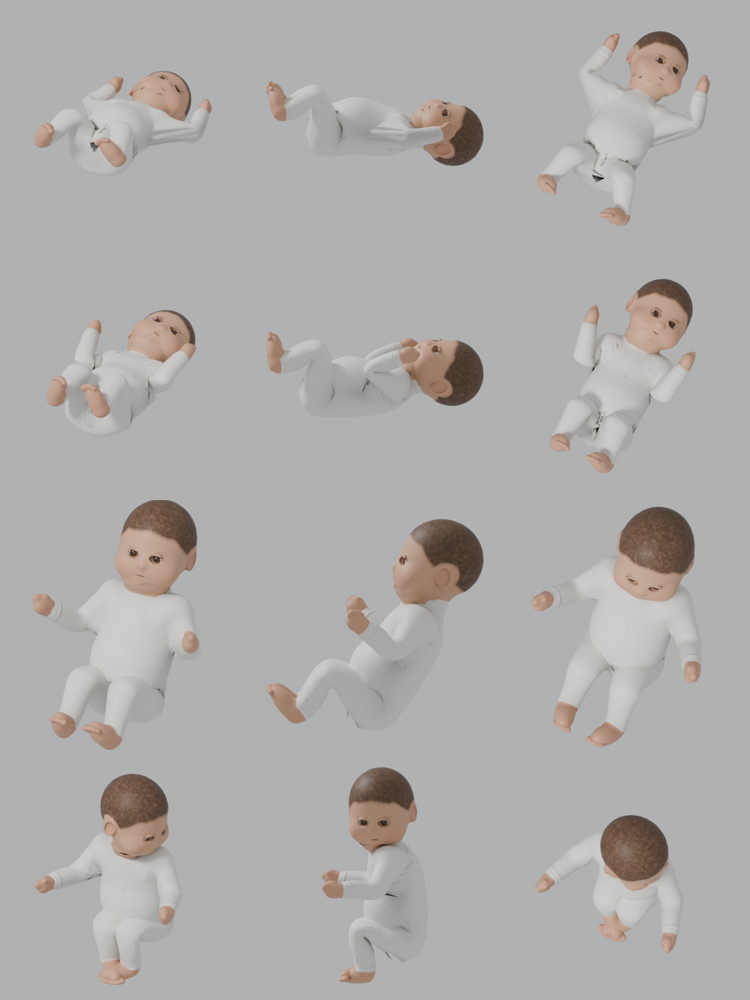
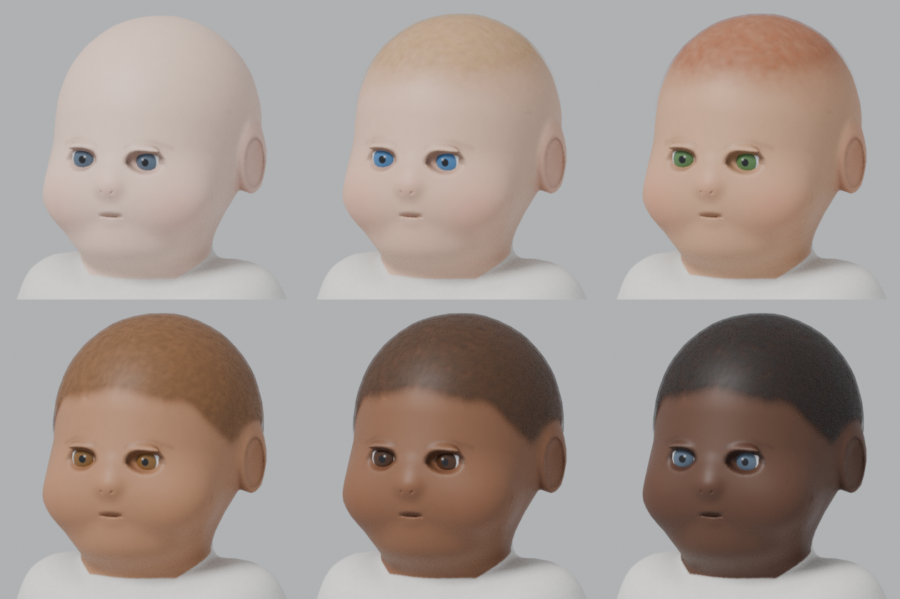

# Bébé Elyzea — modèle 3D original (version 2)

Modèle de nouveau-né **créé de A à Z par génération procédurale**, sans modèle acheté ni modélisation manuelle.
Toute la chaîne (forme, maillage, UV, textures, squelette, poids, poses, conversion GTA V) est automatisée par les scripts de ce dossier.




## Version 2 (ce qui a changé par rapport à la version 1)

| Défaut de la V1 | Correction V2 (modèle et textures réellement régénérés) |
|---|---|
| **Carte de normales inversée dans GTA** : Blender cuit en convention OpenGL, GTA V attend la convention DirectX (Sollumz inverse le vert quand il lit une carte du jeu) → reliefs du visage à l'envers en jeu | canal vert inversé à l'export (`export_gta.py`), vérifié pixel par pixel |
| Cheveux « casque » : découpe alpha tout-ou-rien, aspect moucheté | shader `alpha.sps` (transparence douce) + texture de mèches fines, bord d'implantation fondu |
| Regard « écarquillé » | paupière supérieure posée sur l'œil (géométrie) |
| Narines trop marquées | narines plus petites et moins profondes |
| Peau grise et granuleuse | occlusion adoucie sur la peau, chaleur rosée dans les plis, grain réduit |

Comparaison (rendus Blender, même éclairage) : `build/rendus/comparaison_v1_v2.png` (V1 à gauche, V2 à droite).

## Ce qui a été réellement produit et vérifié

| Élément | Fichier(s) | État |
|---|---|---|
| Forme du bébé (anatomie, 50 cm, proportions de nouveau-né) | `scripts/sdf_baby.py` | Exécuté |
| Maillage source HD (≈ 518 000 triangles, recalculé à chaque génération) | — (non conservé, reproductible) | Exécuté |
| Maillage de jeu : 11 000 triangles, fermé, normales vers l'extérieur | `build/source/bebe_elyzea.blend` | Exécuté, contrôlé |
| UV automatiques | dans le `.blend` / `.glb` / `.fbx` | Exécuté |
| Cartes cuites (Cycles) : normales, occlusion, masques | `build/textures/` | Exécuté |
| Textures finales : 6 teintes de peau, 5 couleurs d'yeux, 2 coiffures × 5 couleurs | `build/textures/` | Exécuté |
| Squelette 20 os (racine, bassin, colonne, poitrine, cou, tête, clavicules, bras, avant-bras, mains, cuisses, tibias, pieds) | `.blend`, `.glb`, `.fbx` | Exécuté, contrôlé |
| Poids de déformation (100 % des sommets) | `.blend`, `.glb`, `.fbx` | Exécuté, contrôlé |
| 4 poses : allongé, porté dans les bras, assis (poussette/siège-auto), porte-bébé ventral | actions dans le `.glb`, `.obj` figés dans `build/poses/` | Exécuté, contrôlé visuellement (rendus) |
| Conversion GTA : 84 modèles `.ydr`, 1 dictionnaire de textures `.ytd` (22 textures DXT avec mipmaps), 1 `.ytyp` (84 archétypes) | `Elyzea Base/elyzea_bebe_modele/stream/` | **Converti et relu** par le lecteur de CodeWalker (sommets, triangles, textures, archétypes) |
| Ressource FiveM avec commandes de test | `Elyzea Base/elyzea_bebe_modele/` | Écrite, syntaxe Lua vérifiée |
| **Affichage dans FiveM** | — | **NON TESTÉ** : aucun client GTA V / FiveM dans mon environnement |

Contrôles automatiques : `python3 scripts/validate.py` → **20/20** (résultat dans `build/validation.json`).

## Choix techniques

**Le bébé est un objet (prop), pas un PNJ.** Un PNJ GTA doit utiliser le squelette humain complet du jeu (≈ 100 os nommés), ses fichiers
`.yft/.ydd/.ymt` et le dictionnaire d'animations des PNJ. Un nouveau-né ne peut pas réutiliser ce squelette d'adulte sans être déformé.
Les scripts de bébé FiveM qui marchent utilisent donc des objets attachés au parent ou posés : c'est ce qui est fait ici.

**Une pose = un modèle figé.** Le squelette sert à fabriquer les poses (et reste fourni pour de futures animations), mais dans le jeu chaque
pose est un modèle statique. Changer de pose = remplacer le modèle (instantané, invisible pour le joueur).

**Variantes sans explosion du nombre de fichiers.** Une pose = 3 pièces qui partagent la même origine :
- corps : 6 teintes de peau (le pyjama blanc cassé fait partie du corps) ;
- yeux : 5 couleurs (globes séparés) ;
- cheveux : 10 variantes (coque de cheveux à alpha découpé), ou « chauve » (aucune pièce).

Les yeux et les cheveux s'attachent au corps **avec un décalage nul** : aucun angle à deviner, aucun risque de décalage.
4 poses × (6 + 5 + 10) = **84 modèles**, tous dans un seul dictionnaire de textures (≈ 12 Mo au total).

**Héritage génétique (module suivant).** Le modèle ne contient aucune règle génétique : l'apparence d'un enfant est un simple trio
`{ teinte, yeux, coiffure }` enregistré à la naissance. Les règles de transmission seront dans la ressource famille.

## Arborescence

```
Outils_3D/bebe/
├── construire.sh            chaîne complète en une commande
├── scripts/
│   ├── sdf_baby.py          anatomie (fonction de distance signée) + extraction de surface
│   ├── generate_baby.py     Blender : maillage, UV, cuissons, textures, squelette, poids, poses, exports, rendus
│   ├── dds.py               textures DDS DXT1/DXT5 avec mipmaps
│   ├── export_gta.py        Blender + Sollumz : 84 drawables, ytyp, ytd -> CodeWalker XML
│   ├── make_resource.py     shared/modeles.lua de la ressource FiveM
│   ├── validate.py          contrôles automatiques
│   └── render_galerie.py    planches de rendu
├── convertisseur/           ElyConvert (C#, CodeWalker.Core) : XML -> .ydr/.ytd/.ytyp + relecture de contrôle
└── build/
    ├── source/              bebe_elyzea.blend, bebe_elyzea_squelette.glb / .fbx
    ├── poses/               4 poses figées en .obj (+ .mtl)
    ├── textures/            PNG : corps (6 teintes), normales, yeux (5), cheveux (10), masques, occlusion
    ├── rendus/              rendus de contrôle Cycles
    ├── rapport_generation.json, validation.json
    └── (gta_xml/, dds/ : intermédiaires régénérés, non versionnés)
```

## Régénérer ou modifier le modèle

1. Python 3.13 : `pip install bpy==5.2.* numpy pillow scikit-image szio==1.3.0.dev9`
2. Sollumz v2.9.0 (extension Blender, GPL) : `git clone --depth 1 --branch v2.9.0 https://github.com/Sollumz/Sollumz.git ~/.config/blender/5.2/scripts/addons/sollumz`
3. .NET 8 SDK et git (le convertisseur clone CodeWalker tout seul).
4. `./construire.sh` (≈ 5 minutes sur 4 cœurs).

Pour ajouter une teinte, une couleur d'yeux ou de cheveux : ajouter une ligne dans `SKIN_TONES`, `EYE_COLORS` ou `HAIR_COLORS`
(`generate_baby.py`) puis relancer `construire.sh`. Pour une nouvelle pose : ajouter une entrée dans `POSES` (rotations des os en degrés).
Pour changer le visage ou les proportions : volumes de `parts()` dans `sdf_baby.py`.

Windows : la chaîne n'a pas été lancée sous Windows. Le plus simple est WSL (Ubuntu) avec les mêmes commandes.

## Limites connues (honnêtes)

- **Pas testé dans FiveM.** Les fichiers binaires sont produits par la bibliothèque officielle de CodeWalker et relus avec succès,
  mais l'affichage en jeu (éclairage, échelle, transparence des cheveux, orientation de la carte de normales) reste à vérifier.
  Si les reliefs paraissent inversés, la carte de normales doit avoir son canal vert inversé : une ligne à changer dans `export_gta.py`.
- **Positions « porté » à régler en jeu** : les valeurs de `Config.Porter` sont des valeurs de départ. `/bebe_ajuster` les règle en direct.
- **Pas d'animation du bébé lui-même** (pleurs, mouvements) : chaque pose est figée. Des animations nécessiteraient un modèle squelettique
  et des fichiers `.ycd` : possible plus tard avec le même squelette, non fait dans cette version.
- **Topologie** : maillage triangulé par décimation (pas de quadrillage propre comme un modèle fait à la main). Sans effet en jeu ;
  moins pratique si quelqu'un veut le retoucher à la main.
- **Cheveux** : coque à transparence douce (`alpha.sps`). Les objets transparents de GTA peuvent montrer de petits défauts de tri
  (ordre d'affichage) sous certains angles : à vérifier en jeu ; repli possible sur `cutout.sps` (une ligne dans `export_gta.py`).
- **Couche** : volume présent sous le pyjama, pas de couche visible séparée. Pas encore de couverture ni de bonnet (prévu en variantes).
- **Pas de collision** : le bébé est attaché ou posé figé ; un objet bébé ne doit pas pouvoir être poussé physiquement.
- Le visage est stylisé (proche des proportions des PNJ de GTA) ; ce n'est pas un scan ni un portrait réaliste.
