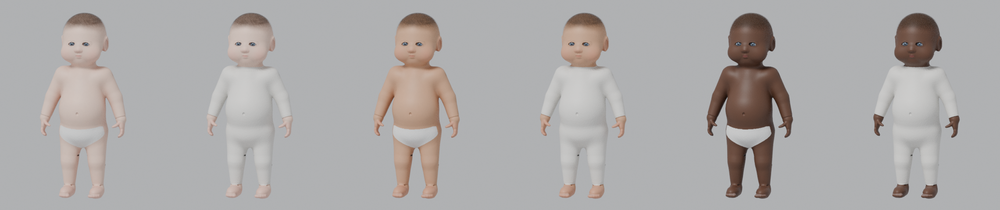
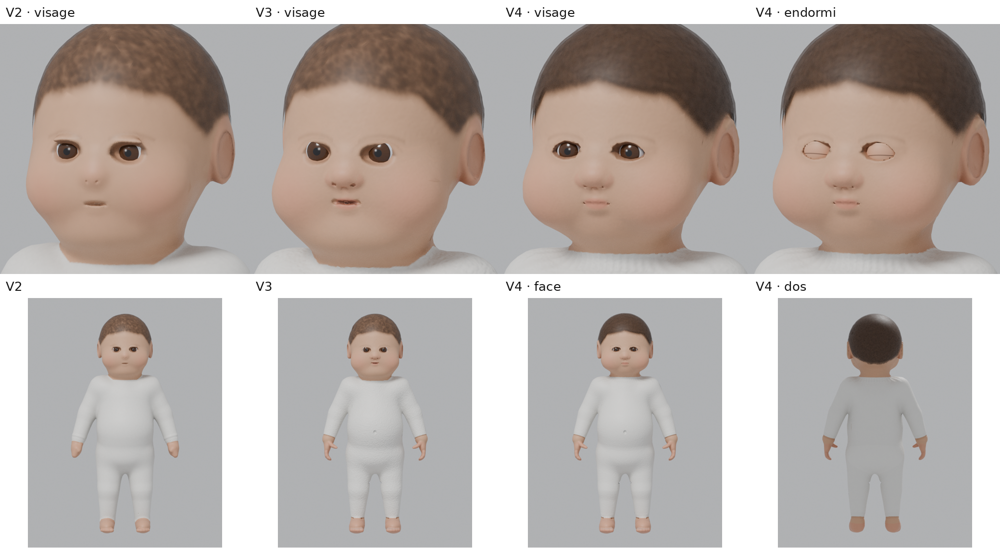
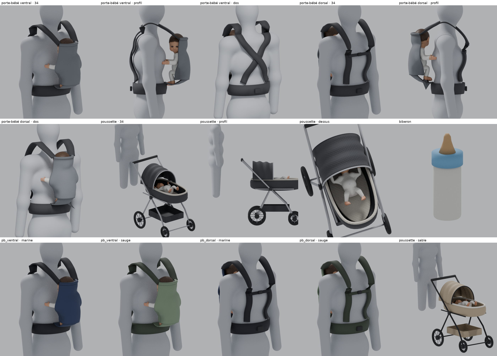
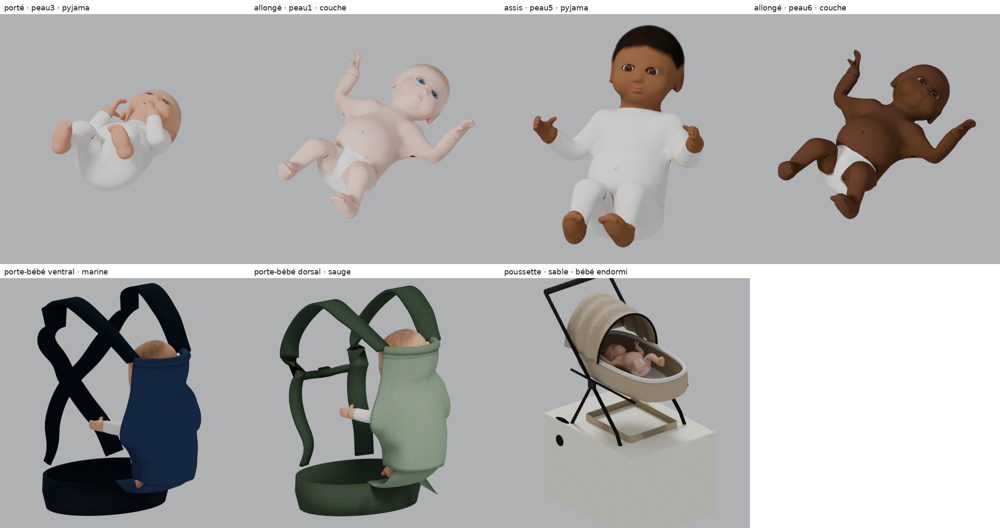

# Bébé Elyzea — modèle 3D original et équipements (version 4)

Modèle de nouveau-né **créé de A à Z par génération procédurale**, sans modèle acheté ni modélisation manuelle.
Toute la chaîne (forme, maillage, UV, textures, squelette, poids, poses, conversion GTA V) est automatisée par les scripts de ce dossier.




## Version 4 (refonte : bébé plus naturel, porte-bébés, poussette)




| Élément | V4 (régénéré, converti, contrôlé) |
|---|---|
| Yeux | coussin de paupière qui recouvre le globe, fente en amande (17 mm) ; bords qui épousent l'œil ; globe aux proportions d'un nouveau-né |
| Bébé endormi | pièce « paupières fermées » (6 teintes) qui remplace les yeux : `ely_bebe_<pose>_paup_<teinte>` |
| Bouche, nez, oreilles | bouche fermée et détendue, narines discrètes, rebord de l'oreille (hélix) |
| Peau | reflet du jeu faible et large (`specularIntensityMult` 0,05, `specularFalloffMult` 14) : fini l'aspect « plastique » |
| Cheveux | deux couches décalées (volume, bord moins « peint ») |
| Pyjama | jersey fin, poignets / chevilles / col côtelés, plis souples aux coudes et genoux (calculés en 3D puis cuits) |
| Porte-bébé ventral et dorsal | `scripts/equipements.py` : construits sur un mannequin adulte, bébé placé automatiquement sans contact avec le corps, 3 coloris |
| Poussette | `scripts/equipements.py` : châssis, roues à rayons, poignée, nacelle, matelas, capote plissée, panier, 2 coloris |

Aperçu rapide du visage pendant les réglages (≈ 1 min au lieu d'une chaîne complète) : `python3 scripts/apercu_visage.py sortie.png`.
Images d'inventaire des équipements : `python3 scripts/icones_equipements.py`.

## Version 3 (demande « bébés beaucoup plus réalistes »)

> **Le niveau de l'image de référence (poupées « reborn » photographiées) n'est pas atteint.** Le modèle reste un modèle de jeu
> généré par programme (16 000 triangles, textures 1024 px), sans sculpture à la main. Comparaison : `build/rendus/comparaison_v2_v3.png`.

| Point demandé | Ce qui a été fait (régénéré, converti, contrôlé) |
|---|---|
| Mains | paumes, 4 doigts à 3 phalanges légèrement repliés, pouce à 2 segments, ongles, plis des poignets ; plus de pixels de texture pour les mains |
| Pieds | talon, voûte, 5 orteils, ongles, plis des chevilles |
| Corps potelé | ventre rond, nombril, cuisses et bras plus pleins, plis internes des cuisses |
| Visage | joues plus rondes, nez petit (arête basse, ailes, narines), bouche de nouveau-né (lèvre supérieure en arc, lèvre inférieure pleine, intérieur sombre), menton ; orbites redessinées, iris plus grand, blanc de l'œil ombré dans les coins ; plus de pixels de texture pour le visage |
| Peau | peau légèrement marbrée, rougeurs (joues, nez, mains, pieds, genoux, coudes, oreilles), lèvres, ongles ; micro-relief très léger |
| Tenues | **nouveau** : `couche` (corps visible) ou `pyjama` (par défaut), pour les 6 teintes (même forme, textures différentes) |
| Toutes les variantes | 4 poses × (6 teintes × 2 tenues + 5 yeux + 10 coiffures) = **108 modèles** |

Défauts trouvés et corrigés pendant la V3 (constatés sur les rendus, pas supposés) :
- **UV superposées** (905 faces partageaient la même zone de texture → morceaux de peau sur le pyjama, tache sur le menton) :
  le dépliage repère maintenant ces faces et les redéplie jusqu'à 0 ; contrôle ajouté dans `validate.py`.
- **Peau étirée dans la pose allongée** (bras levé : « membrane » entre le bras et le torse, couche étirée sur la cuisse), visible
  uniquement en rendant **les fichiers du jeu** : poids de déformation lissés (la tête reste rigide), pose moins ouverte
  (704 → 66 arêtes de plus de 2 cm) ; contrôle ajouté.
- Traits noirs du pyjama aux aines (occlusion trop forte sur le tissu), relief de peau trop granuleux, masque des lèvres mal placé.

Limites qui restent : expression encore figée (yeux un peu petits, regard fixe), cheveux en « coque » peinte (pas de mèches en relief),
petites marques sombres aux aines dans certaines poses, nombril visible à travers le pyjama (même forme pour les deux tenues).

**Rendu à partir des fichiers du jeu** (`scripts/rendu_jeu.py`, étape 7 de `construire.sh`) : les `.ydr` / `.ytd` du dossier `stream/`
sont relus par CodeWalker (`convertisseur/relire.sh`), réimportés par Sollumz et rendus → `build/rendus/fichiers_du_jeu.png`.
Cela vérifie le contenu exact de ce que FiveM chargera (forme, UV, textures compressées, carte de normales), **pas** le rendu du moteur de GTA V.



## Version 2 (ce qui a changé par rapport à la version 1)

| Défaut de la V1 | Correction V2 (modèle et textures réellement régénérés) |
|---|---|
| **Carte de normales inversée dans GTA** : Blender cuit en convention OpenGL, GTA V attend la convention DirectX (Sollumz inverse le vert quand il lit une carte du jeu) → reliefs du visage à l'envers en jeu | canal vert inversé à l'export (`export_gta.py`), vérifié pixel par pixel |
| Cheveux « casque » : découpe alpha tout-ou-rien, aspect moucheté | shader `alpha.sps` (transparence douce) + texture de mèches fines, bord d'implantation fondu |
| Regard « écarquillé » | paupière supérieure posée sur l'œil (géométrie) |
| Narines trop marquées | narines plus petites et moins profondes |
| Peau grise et granuleuse | occlusion adoucie sur la peau, chaleur rosée dans les plis, grain réduit |

Comparaison (rendus Blender, même éclairage) : `build/rendus/comparaison_v1_v2.png` (V1 à gauche, V2 à droite).

## Ce qui a été réellement produit et vérifié

| Élément | Fichier(s) | État |
|---|---|---|
| Forme du bébé (anatomie, 50 cm, proportions de nouveau-né) | `scripts/sdf_baby.py` | Exécuté |
| Maillage source HD (≈ 518 000 triangles, recalculé à chaque génération) | — (non conservé, reproductible) | Exécuté |
| Maillage de jeu : 16 000 triangles, fermé, normales vers l'extérieur, UV sans superposition | `build/source/bebe_elyzea.blend` | Exécuté, contrôlé |
| UV automatiques | dans le `.blend` / `.glb` / `.fbx` | Exécuté |
| Cartes cuites (Cycles) : normales, occlusion, masques | `build/textures/` | Exécuté |
| Textures finales : 6 teintes × 2 tenues, 2 cartes de relief, 5 couleurs d'yeux, 2 coiffures × 5 couleurs | `build/textures/` | Exécuté |
| Squelette 20 os (racine, bassin, colonne, poitrine, cou, tête, clavicules, bras, avant-bras, mains, cuisses, tibias, pieds) | `.blend`, `.glb`, `.fbx` | Exécuté, contrôlé |
| Poids de déformation (100 % des sommets) | `.blend`, `.glb`, `.fbx` | Exécuté, contrôlé |
| 4 poses : allongé, porté dans les bras, assis (poussette/siège-auto), porte-bébé ventral | actions dans le `.glb`, `.obj` figés dans `build/poses/` | Exécuté, contrôlé visuellement (rendus) |
| Conversion GTA : 108 modèles `.ydr`, 2 dictionnaires `.ytd` (corps : 14 textures, 6,7 Mo ; yeux + cheveux : 15 textures), 1 `.ytyp` (108 archétypes) | `Elyzea Base/elyzea_bebe_modele/stream/` | **Converti et relu** par le lecteur de CodeWalker (111/111), puis rendu à partir des fichiers relus |
| Ressource FiveM avec commandes de test | `Elyzea Base/elyzea_bebe_modele/` | Écrite, syntaxe Lua vérifiée |
| **Affichage dans FiveM** | — | **NON TESTÉ** : aucun client GTA V / FiveM dans mon environnement |

Contrôles automatiques : `python3 scripts/validate.py` → **37/37** (V4) (dont UV sans superposition, peau peu étirée par pose, fichiers < 16 Mo) (résultat dans `build/validation.json`).

## Choix techniques

**Le bébé est un objet (prop), pas un PNJ.** Un PNJ GTA doit utiliser le squelette humain complet du jeu (≈ 100 os nommés), ses fichiers
`.yft/.ydd/.ymt` et le dictionnaire d'animations des PNJ. Un nouveau-né ne peut pas réutiliser ce squelette d'adulte sans être déformé.
Les scripts de bébé FiveM qui marchent utilisent donc des objets attachés au parent ou posés : c'est ce qui est fait ici.

**Une pose = un modèle figé.** Le squelette sert à fabriquer les poses (et reste fourni pour de futures animations), mais dans le jeu chaque
pose est un modèle statique. Changer de pose = remplacer le modèle (instantané, invisible pour le joueur).

**Variantes sans explosion du nombre de fichiers.** Une pose = 3 pièces qui partagent la même origine :
- corps : 6 teintes de peau × 2 tenues (couche ou pyjama blanc cassé, peints sur le corps) ;
- yeux : 5 couleurs (globes séparés) ;
- cheveux : 10 variantes (coque de cheveux à alpha découpé), ou « chauve » (aucune pièce).

Les yeux et les cheveux s'attachent au corps **avec un décalage nul** : aucun angle à deviner, aucun risque de décalage.
4 poses × (12 + 5 + 10 + 6 paupières) = **132 modèles** de bébé + 8 équipements = **140 modèles**, trois dictionnaires de textures (chacun sous la limite de 16 Mo de FiveM).

**Héritage génétique (module suivant).** Le modèle ne contient aucune règle génétique : l'apparence d'un enfant est un simple trio
`{ teinte, tenue, yeux, coiffure }` enregistré à la naissance. Les règles de transmission seront dans la ressource famille.

## Arborescence

```
Outils_3D/bebe/
├── construire.sh            chaîne complète en une commande
├── scripts/
│   ├── sdf_baby.py          anatomie (fonction de distance signée) + extraction de surface
│   ├── generate_baby.py     Blender : maillage, UV, cuissons, textures, squelette, poids, poses, exports, rendus
│   ├── dds.py               textures DDS DXT1/DXT5 avec mipmaps
│   ├── export_gta.py        Blender + Sollumz : 108 drawables, ytyp, 2 ytd -> CodeWalker XML
│   ├── make_resource.py     shared/modeles.lua de la ressource FiveM
│   ├── validate.py          contrôles automatiques
│   ├── render_galerie.py    planches de rendu (teintes, tenues, poses)
│   └── rendu_jeu.py         rendu à partir des fichiers du jeu relus
├── convertisseur/           ElyConvert (C#, CodeWalker.Core) : XML -> .ydr/.ytd/.ytyp + relecture ; relire.sh : binaire -> XML
└── build/
    ├── source/              bebe_elyzea.blend, bebe_elyzea_squelette.glb / .fbx
    ├── poses/               4 poses figées en .obj (+ .mtl)
    ├── textures/            PNG : corps (6 teintes × 2 tenues), reliefs (2), yeux (5), cheveux (10), masques, occlusion
    ├── rendus/              rendus de contrôle Cycles
    ├── rapport_generation.json, validation.json
    └── (gta_xml/, dds/, relu/ : intermédiaires régénérés, non versionnés)
```

## Régénérer ou modifier le modèle

1. Python 3.13 : `pip install bpy==5.2.* numpy pillow scikit-image szio==1.3.0.dev9`
2. Sollumz v2.9.0 (extension Blender, GPL) : `git clone --depth 1 --branch v2.9.0 https://github.com/Sollumz/Sollumz.git ~/.config/blender/5.2/scripts/addons/sollumz`
3. .NET 8 SDK et git (le convertisseur clone CodeWalker tout seul).
4. `./construire.sh` (≈ 35 minutes sur 4 cœurs : bébé 9 min, équipements 2 min, export et conversion, rendus).

Pour ajouter une teinte, une couleur d'yeux ou de cheveux : ajouter une ligne dans `SKIN_TONES`, `EYE_COLORS` ou `HAIR_COLORS`
(`generate_baby.py`) puis relancer `construire.sh`. Pour une nouvelle pose : ajouter une entrée dans `POSES` (rotations des os en degrés).
Pour changer le visage ou les proportions : volumes de `parts()` dans `sdf_baby.py`.

Windows : la chaîne n'a pas été lancée sous Windows. Le plus simple est WSL (Ubuntu) avec les mêmes commandes.

## Limites connues (honnêtes)

- **Pas testé dans FiveM.** Les fichiers binaires sont produits par la bibliothèque officielle de CodeWalker et relus avec succès,
  mais l'affichage en jeu (éclairage, échelle, transparence des cheveux, orientation de la carte de normales) reste à vérifier.
  Si les reliefs paraissent inversés, la carte de normales doit avoir son canal vert inversé : une ligne à changer dans `export_gta.py`.
- **Positions « porté » à régler en jeu** : les valeurs de `Config.Porter` sont des valeurs de départ. `/bebe_ajuster` les règle en direct.
- **Pas d'animation du bébé lui-même** (pleurs, mouvements) : chaque pose est figée. Des animations nécessiteraient un modèle squelettique
  et des fichiers `.ycd` : possible plus tard avec le même squelette, non fait dans cette version.
- **Topologie** : maillage triangulé par décimation (pas de quadrillage propre comme un modèle fait à la main). Sans effet en jeu ;
  moins pratique si quelqu'un veut le retoucher à la main.
- **Cheveux** : coque à transparence douce (`alpha.sps`). Les objets transparents de GTA peuvent montrer de petits défauts de tri
  (ordre d'affichage) sous certains angles : à vérifier en jeu ; repli possible sur `cutout.sps` (une ligne dans `export_gta.py`).
- **Couche** : volume présent sous le pyjama, pas de couche visible séparée. Pas encore de couverture ni de bonnet (prévu en variantes).
- **Pas de collision** : le bébé est attaché ou posé figé ; un objet bébé ne doit pas pouvoir être poussé physiquement.
- Le visage est stylisé (proche des proportions des PNJ de GTA) ; ce n'est pas un scan ni un portrait réaliste.
